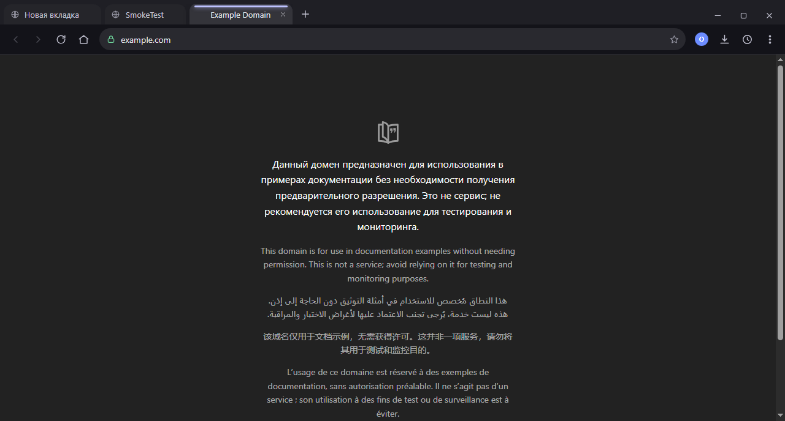
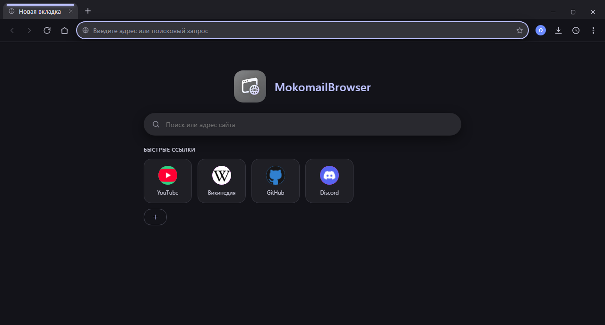
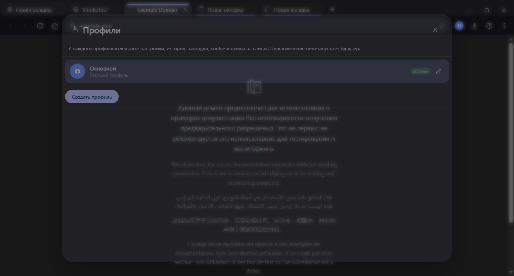
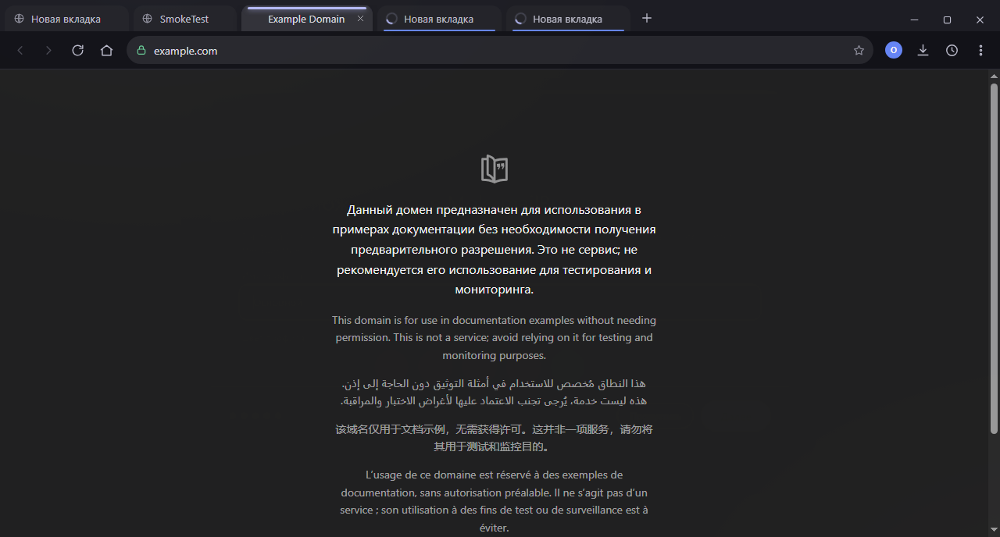
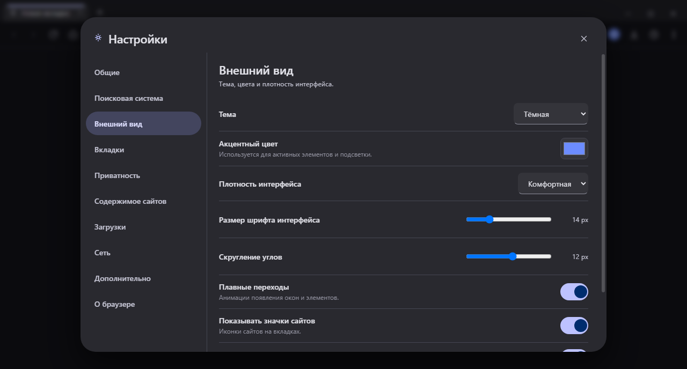

# MokomailBrowser

Полноценный веб-браузер на базе **Chromium (Electron)** в оформлении **Material 3**:
вкладки и **группы вкладок**, **профили**, **режим инкогнито**,
адресная строка с подсказками, закладки, **полная история в JSON**, загрузки, поиск по
странице, **палитра команд**, **снимки страниц**, **закреплённые вкладки**, более
**40 рабочих настроек** и **мастер первоначальной настройки** при первом запуске.

> Сделано командой **MokomailTeam** · TikTok [@mokomail](https://www.tiktok.com/@mokomail) ·
> GitHub [github.com/mokomail](https://github.com/mokomail)




*Страница реально отрисована в `<webview>` — 1280×639, видима, без ошибок загрузки.*





*Профили: у каждого свои настройки, история, закладки, cookie и входы на сайтах.*



*Мастер первого запуска: имя профиля, поиск, тема и акцент — в стиле Material 3.*

---

## Возможности

### Первоначальная настройка
- Мастер при первом запуске: **имя профиля**, **поисковая система**, **тема** и
  **акцентный цвет**, приватность и восстановление вкладок
- **Живой предпросмотр** темы и опорного цвета: цветовые схемы строятся по правилам
  Material 3 (тональные палитры в перцептивном пространстве)
- Запустить снова: **Настройки → Общие → Первоначальная настройка** или
  **Меню → Повторить начальную настройку**

### Оформление (Material 3)
- Дизайн-система **Material 3**: цветовые роли, скругления, кнопки, поля, меню,
  переключатели, диалоги и «звёздочка» состояния
- Цветовая схема **строится из одного опорного цвета** — светлая и тёмная темы
- Тема «как в системе», светлая или тёмная

### Вкладки и навигация
- Вкладки: создание, закрытие, переключение, **перетаскивание для изменения порядка**
- **Группы вкладок**: создание, переименование, цвет, сворачивание (правый клик по вкладке)
- Закрытие вкладки средней кнопкой мыши, «Показать в фоне» при открытии ссылок
- Восстановление последней закрытой вкладки (`Ctrl+Shift+T`), восстановление групп сессии
- Кнопки «Назад», «Вперёд», «Обновить/Стоп», «Домой»
- Индикатор загрузки и спиннер прямо на вкладке
- Масштабирование страниц с индикатором (`Ctrl +/−/0`)

### Профили и приватность
- **Профили**: у каждого свои настройки, история, закладки, cookie, кэш и входы на сайтах;
  переключение перезапускает браузер с выбранным профилем
- **Режим инкогнито** (отдельное окно, `Ctrl+Shift+N`): данные не сохраняются на диск,
  история не ведётся, окно визуально отличается
- Блокировка всплывающих окон, `Do Not Track`, очистка данных при выходе

### Адресная строка (омнибокс)
- Понимает и адреса, и поисковые запросы
- **Подсказки**: переход по ссылке, живой поиск, совпадения из истории и закладок
- Управление с клавиатуры: `↑`/`↓`, `Enter`, `Alt+Enter` — открыть в новой вкладке
- Индикатор безопасности: 🔒 HTTPS, ⚠️ незащищённое соединение, внутренние страницы
- Кнопка «звёздочка» для быстрого добавления в закладки

### Стартовая страница
- Поиск прямо со стартовой страницы
- **Быстрые ссылки** с иконками сайтов: добавление и удаление (хранятся в настройках)
- **«Часто посещаемые»** — топ сайтов из истории с иконками (отключается в настройках)

### Данные
- **История в JSON**: по одной записи на адрес, со счётчиком посещений, датами первого и
  последнего визита; поиск, сортировка, группировка по дням, удаление, экспорт и импорт,
  очистка. В инкогнито история не ведётся.
- **Закладки**: панель закладок, менеджер, редактирование и удаление, **экспорт и импорт в JSON**
- **Загрузки**: прогресс, пауза/продолжение, отмена, открытие файла и показ в папке
- Восстановление сессии между запусками (вкладки и группы)

### Прочее
- **Палитра команд** (`Ctrl+Shift+P`): быстрый доступ к действиям, вкладкам, истории,
  закладкам и быстрым ссылкам из одного окна
- **Снимок страницы** (`Ctrl+Shift+S`): сохранить видимую часть страницы в PNG
- **Закреплённые вкладки**: сжимаются до иконки, не закрываются пачкой (меню вкладки)
- **Дублирование вкладки** и **выключение звука** вкладки (`Ctrl+M`)
- Контекстное меню по правому клику (ссылки, изображения, текст, навигация, «Просмотреть код»)
- Поиск на странице (`Ctrl+F`) с количеством совпадений
- Приложение-меню (классическая строка меню вызывается клавишей `Alt`)
- Тёмная, светлая тема или «как в системе», настраиваемый акцентный цвет
- **О браузере**: отдельный раздел настроек с версией, технологиями и ссылками на соцсети
- **Адаптивный интерфейс под любое разрешение**: при маленьком окне меню «⋮» и списки
  получают прокрутку, разделы настроек складываются в колонку, окно ужимается до 420×380
- Уведомления (toast) о событиях

---

## Настройки



Разделы настроек полностью рабочие — ни одного «декоративного» переключателя.

| Раздел | Что настраивается |
|---|---|
| **Общие** | Поведение при запуске, подтверждение закрытия окна, повторный запуск мастера настройки |
| **Поисковая система** | Поисковая система (DuckDuckGo, Google, Яндекс, Bing, Brave, Ecosia, Startpage или своя), **домашняя страница** (меняется вместе с поисковиком), синхронизация с поисковиком, подсказки, открытие поиска в новой вкладке |
| **Внешний вид** | Тема, акцентный цвет, плотность интерфейса, размер шрифта, скругление углов, анимации, значки сайтов, панель закладок, блок «Часто посещаемые» |
| **Вкладки** | Расположение (сверху / слева), группы вкладок, открытие в фоне, предупреждение при закрытии, запоминание сессии, восстановление закрытой вкладки |
| **Приватность** | Блокировка всплывающих окон, `Do Not Track`, очистка данных при выходе |
| **Содержимое сайтов** | JavaScript, блокировка изображений, автовоспроизведение, масштаб по умолчанию |
| **Загрузки** | Папка загрузок, запрос места сохранения, панель загрузок |
| **Сеть** | Прокси (системный / без прокси / вручную), исключения, свой `User-Agent` |
| **Дополнительно** | Аппаратное ускорение, DevTools, **профили** (создание, переименование, удаление), очистка кэша и истории, сброс настроек |
| **О браузере** | Версия, используемые технологии (Electron, Chromium), ссылки на соцсети команды |

---

## Горячие клавиши

| Действие | Клавиши |
|---|---|
| Новая вкладка | `Ctrl+T` |
| Новое окно | `Ctrl+N` |
| **Новое окно инкогнито** | `Ctrl+Shift+N` |
| Закрыть вкладку | `Ctrl+W` |
| Восстановить вкладку | `Ctrl+Shift+T` |
| Закрепить/открепить вкладку | из меню вкладки |
| Выключить/включить звук вкладки | `Ctrl+M` |
| Следующая / предыдущая вкладка | `Ctrl+Tab` / `Ctrl+Shift+Tab` |
| Вкладка по номеру | `Ctrl+1` … `Ctrl+9` |
| Адресная строка | `Ctrl+L` |
| Обновить / без кэша | `F5` / `Ctrl+Shift+R` |
| Назад / вперёд | `Alt+←` / `Alt+→` |
| Домой | `Alt+Home` |
| Масштаб | `Ctrl++` / `Ctrl+−` / `Ctrl+0` |
| Найти на странице | `Ctrl+F` |
| **Палитра команд** | `Ctrl+Shift+P` |
| **Снимок страницы** | `Ctrl+Shift+S` |
| Добавить в закладки | `Ctrl+D` |
| История / закладки / загрузки | `Ctrl+H` / `Ctrl+Shift+O` / `Ctrl+J` |
| Настройки | `Ctrl+,` |
| Панель закладок | `Ctrl+Shift+B` |
| DevTools | `Ctrl+Shift+I` |
| Полный экран | `F11` |
| Строка меню | `Alt` |

---

## Структура проекта

```
mokomail-browser/
├── package.json            # зависимости + конфигурация сборки (раздел "build")
├── .npmrc                  # локальный реестр npm для этого проекта
├── .gitignore
├── README.md
├── assets/
│   └── icons/
│       └── icon.png        # иконка приложения
├── build/
│   └── installer.nsh       # очистка данных предыдущей сборки при установке
├── dist/                   # готовые сборки (создаётся при npm run dist)
├── docs/                   # скриншоты
├── scripts/
│   ├── generate-icon.py    # генератор иконки (только стандартная библиотека Python)
│   └── clean-browser-data.js # очистка истории и сессий перед сборкой
└── src/
    ├── shared/
    │   └── search-engines.js    # список поисковых систем
    ├── main/                    # главный процесс (Node.js)
    │   ├── main.js              # окно, профили, инкогнито, жизненный цикл, сессия
    │   ├── ipc.js               # все IPC-обработчики (история, профили, окна)
    │   ├── menu.js              # строка меню приложения
    │   ├── profiles.js          # реестр профилей и их папок данных
    │   ├── session-config.js    # разделы, прокси, User-Agent, DNT, блокировка изображений
    │   ├── context-menu.js      # контекстное меню страниц
    │   ├── downloads.js         # менеджер загрузок (для нескольких разделов)
    │   ├── settings-defaults.js # значения настроек по умолчанию
    │   └── store.js             # JSON-хранилище
    ├── preload/
    │   └── preload.js           # безопасный мост renderer ↔ main
    └── renderer/                # интерфейс
        ├── index.html
        ├── styles.css
        ├── icons.js             # SVG-иконки
        ├── material.js          # Material 3: цветовые схемы из опорного цвета
        ├── core.js              # утилиты, состояние, тема
        ├── tabs.js              # вкладки, группы, webview
        ├── ui.js                # панель инструментов, омнибокс, подсказки, топ сайтов
        ├── panels.js            # настройки, история, закладки, загрузки, профили, «О браузере»
        ├── palette.js           # палитра команд (Ctrl+Shift+P)
        ├── onboarding.js        # мастер первоначальной настройки
        └── app.js               # запуск, горячие клавиши, IPC
```

### Как это устроено

- **Главный процесс** управляет окном, профилями, хранилищами (настройки, история, закладки,
  сессия), меню приложения, загрузками и политиками сети.
- **Renderer** строит интерфейс, а каждая вкладка — это отдельный `<webview>`.
- **Разделы (partitions).** Основной профиль использует постоянный раздел
  `persist:mokomail-<профиль>`, а инкогнито — раздел без префикса `persist:`, поэтому его
  данные живут только в памяти. К каждому разделу применяются прокси, `User-Agent`, DNT и
  блокировка изображений.
- **Профили** хранятся в `profiles.json`; данные каждого профиля лежат в
  `profiles/<id>/`. Переключение профиля перезапускает приложение с `--profile=<id>`.
- **Preload** через `contextBridge` даёт интерфейсу только разрешённый набор методов
  (`nodeIntegration` выключен, `contextIsolation` включён).
- **Material 3.** Роли цвета (`--md-primary`, `--md-surface`, `--md-outline` и т.д.)
  вычисляются в `material.js` из опорного цвета профиля методом тональных палитр M3 и
  подставляются как CSS-переменные; вёрстка использует их в `styles.css`.
- Данные хранятся в папке пользователя Electron в виде JSON — открыть её можно из
  «Настройки → Дополнительно → Открыть папку с данными».

---

## Запуск

```bash
npm install     # установить зависимости (Electron)
npm start       # запустить браузер
```

Режим самопроверки (запускается, проверяет состояние интерфейса, сохраняет
скриншоты в `docs/` и выходит):

```bash
npx electron . --smoketest
```

---

## Сборка в .exe

Проект упаковывается в готовые файлы для Windows через `electron-builder`:

```bash
npm run dist       # собрать установщик и портативную версию
npm run dist:dir   # быстрая распакованная сборка (без установщика)
```

Перед каждой сборкой автоматически запускается очистка данных
(`scripts/clean-browser-data.js`, скрипт `predist`): из каждого профиля удаляются
история браузера, сессия восстановления вкладок и **настройки профиля** — поэтому
новая сборка при первом запуске открывается с **первоначальной настройкой**
(значения по умолчанию уже содержат актуальные быстрые ссылки: Discord и иконки
сайтов, без OpenCode). Стереть данные вручную можно командой:

```bash
npm run clean:data
```

Дополнительно **установщик** (`build/installer.nsh`) при установке удаляет папку
данных предыдущей сборки (`%APPDATA%\MokomailBrowser`) — это гарантирует «чистый»
первый запуск даже при переустановке поверх старой версии.

Результат появляется в папке `dist/`:

| Файл | Что это |
|---|---|
| `MokomailBrowser-0.1.0-beta-setup.exe` | **Установщик в один клик** (NSIS): ставит браузер без вопросов, создаёт ярлыки на рабочем столе и в меню «Пуск» |
| `MokomailBrowser-0.1.0-beta-portable.exe` | Портативная версия — один файл, запускается без установки |
| `win-unpacked/` | Распакованное приложение (`MokomailBrowser.exe`) |

Портативная версия при первом запуске распаковывается во временную папку,
поэтому стартует на несколько секунд дольше — это нормально.

Собираются только **64-битные сборки (x64)** — как и было запрошено, без версий для 32 бит и ARM.

---

## Примечания

- **Файл `.npmrc`.** В этом проекте лежит локальный `.npmrc` с адресом
  `https://registry.npmjs.org/`, потому что в пользовательском конфиге npm был указан
  `https://npmjs.org` (это сайт, а не реестр), из-за чего установка пакетов падала с `403`.
- **CSP.** В `index.html` задана строгая политика `Content-Security-Policy`
  (`script-src 'self'`), поэтому предупреждение Electron о безопасности не появляется.
- **Chromium.** Electron использует собственную сборку Chromium — отдельный браузер
  в проект класть не нужно. Версии видны в «Настройки → Дополнительно».
- **Подпись.** Готовые `.exe` не подписаны цифровым сертификатом, поэтому Windows
  SmartScreen может показать предупреждение при первом запуске — это ожидаемо для
  сборки без купленного сертификата.
- **Скриншоты** в `docs/` пересоздаются самопроверкой.

## Команда и ссылки

**MokomailBrowser** делает команда **MokomailTeam**.

- 🎵 TikTok: [@mokomail](https://www.tiktok.com/@mokomail)
- 🐙 GitHub: [github.com/mokomail](https://github.com/mokomail)

Ссылки также открываются прямо из браузера: **Меню → О браузере**, **Справка** и на
последнем шаге первоначальной настройки.

## Лицензия

MIT
